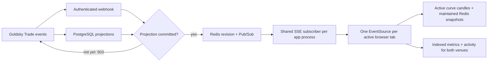

# Live market updates

The existing Goldsky pipeline now has a second destination for `camp_trades`:



`POST /api/webhooks/goldsky` requires `Authorization: Bearer <KORUM_GOLDSKY_WEBHOOK_SECRET>`.
The secret is server-only, at least 32 characters, and must match Goldsky's
`KORUM_STAGING_MARKET_WEBHOOK` httpauth secret (`secretKey: Authorization`,
`secretValue: Bearer <token>`). `REDIS_URL` must be configured on the app service.
The pipeline targets the existing staging app's public domain.

Goldsky decodes `Graduated.poolId` (`bytes32`) as hex without `0x`. The graduation
transform adds exactly one prefix and lowercases the result, preserving all 32
bytes for PostgreSQL's `camp_graduations_pool_id_format` constraint. Numeric event
parameters use exact `DECIMAL(78, 0)` casts; current Turbo versions removed
`to_u256`. Check changes with `goldsky turbo validate` and
`node --env-file=.env.local scripts/check-goldsky-graduations.mjs` (SELECT-only
PostgreSQL checks). Apply updates under the existing pipeline and source names
to preserve their checkpoints.

The endpoint validates the chain, addresses, hashes, operation and event ID,
accepts at most 100 rows/128 KiB, and waits up to eight PostgreSQL readiness checks.
It returns 503 if indexing or Redis is unavailable so Goldsky retries. It never
writes or fabricates blockchain trades in PostgreSQL. Insert/update notices wait
for the exact block hash and market metadata; deletes wait for that version to
be absent. Within one batch only the final operation for an event is retained.

Redis atomically deduplicates each event's latest operation/block hash (24-hour
retention), advances the market-cache revision, then publishes token addresses and confirmed trade values for insertions. A bounded
PostgreSQL read loads price, circulating-supply market cap, volume, timestamp and
block/log cursor for active curve trades once per webhook batch, independently
of the subscriber count. Pool/graduating trades still notify subscribers but
do not produce incremental candle payloads.
The predecessor cursor detects a missing trade; updates/deletes request snapshot
recovery. There are no additional blockchain RPC calls.
All replicas use the same namespace. An in-flight request on an old revision
cannot refill the new revision's cache. Live snapshot routes use `no-store` for
HTTP caching; shared Redis caching and request deduplication remain enabled.
`KORUM_CACHE_NAMESPACE` optionally isolates integration-test cache/broadcast keys;
leave it unset for the normal deployment.

The indexed Versus snapshots shared by Explore Table, Analytics Top VS and Profile
Watchlist calculate 5m, 1h, 6h and 24h changes independently. Each compares the
current indexed token price to the final trade price at or before the window's
start, ordered by trade time and then block/log position. Before the first trade,
the reference is the initial curve price (`virtual_eth / total_supply`). Missing
or invalid prices remain unavailable rather than becoming a fabricated zero.
The calculation uses ETH prices, so a refreshed ETH/USD quote cannot introduce
a spurious token return. The 24h change is independent of the 96-trade sparkline
limit. Explore and Top VS refresh these snapshots every 15
seconds; the visible authenticated Watchlist does the same and refreshes on
focus/return to the tab, without adding polling to each star button.

With Redis and authenticated live delivery configured, these requests reuse a
maintained catalog of the latest 250 indexed Versus, shared across list limits,
Top VS, detail pages and users' watchlists. Older requested IDs use maintained
per-Versus entries. The ten-minute TTL measures inactivity: a read renews it,
so a quiet market stays cached beyond 15 seconds and does not periodically
reload PostgreSQL. A snapshot keeps each token's last 24 hours of trade times,
exact price/volume values and the price preceding that history. The server slides
5m/1h/6h/24h references, 24h volume/trade counts and sparklines from this timeline
without another SQL read. The separately cached ETH/USD quote can refresh without
rebuilding market data.

Before publishing a trade batch, the webhook refreshes only affected warm Versus
rows from PostgreSQL, including holder/trader counts and market state. It replaces
them in the catalog and any warm detail entries atomically with chart updates,
event deduplication and SSE publication. Other Versus remain reusable; duplicate
deliveries skip those market reads. Unknown token addresses invalidate catalog
discovery. Updates/deletions use the authoritative projection rather than adding
the same trade twice. Publications preserve idle TTLs. One Redis lease per
snapshot coalesces cold loads across replicas, and revision checks fence off
fills started before a trade or metadata edit. Waiting requests do not start
parallel SQL reconstructions when another replica owns the lease.

Creation, lifecycle, graduation, recipient and creator-name changes also need
detection without a trade. A Redis lease limits their metadata fingerprint probe
to once per minute across all replicas, while the site receives requests. This
reads control-plane rows, not trade history, holder counts or OHLC aggregates.
Unchanged metadata leaves market snapshots intact; a changed fingerprint
invalidates them for one shared reconstruction. Metadata API edits advance the
same guard immediately. This check's SQL frequency is independent of visitor
count, though its work grows with metadata size. Trade freshness still relies on
webhook delivery: this metadata probe does not scan for missed trades.

Watchlist membership is a separate private maintained cache keyed by deployment,
chain and authenticated user. A first/idle-expired visit loads that user's IDs;
adding/removing a favorite invalidates only those IDs. Trades do not invalidate
membership, and repeated watchlist polling hydrates markets from the public
catalog rather than repeating a heavy per-user market query. HTTP responses
remain `private, no-store`. Search caches matching IDs separately for 45 seconds
and hydrates their current market data from maintained snapshots.

Without Redis/live configuration, or if Redis cannot connect, list/detail reads
retain the existing short request-cache/database fallback. The shared guarantees
therefore require Redis and live delivery. During a shared reconstruction,
contention or repeated revision races return a retryable route error instead of
multiplying SQL loads. Tests: `node scripts/check-debate-cache.mjs` against a
local/test Redis (unique temporary namespace, no PostgreSQL writes), and
`node --env-file=.env.local scripts/check-market-price-changes.mjs --live` for
SELECT-only schema/calculation verification.

`GET /api/markets/live?tokens=0x...&feed=1` uses SSE. Token subscriptions are limited
to 20; `feed=1` requests all trade notifications for the Explore ticker. There is
one Redis subscriber per process and one browser connection shared by both token
panels and the ticker. Connections have heartbeats, bounded buffers, a four-minute
lifetime and an opening-rate budget. Hidden tabs close the stream. Disconnecting
restores polling; reconnecting triggers fresh snapshots rather than claiming
lossless event replay. Only the latest chart page is synchronized every 60 seconds while connected
(or the existing slower interval for long resolutions), and every 5 seconds or
the existing slower interval when disconnected. Hidden tabs do not poll. Closed
history pages are not reloaded by periodic synchronization.

For tokens still on an active bonding curve, the browser applies confirmed trades directly to the active chart's current
bucket, or appends a new bucket. OHLC, market cap and volume are merged in chain
order for every resolution. Duplicate cursors are ignored. A missing predecessor or reconnection requests the maintained snapshot; an indexed
update/deletion invalidates the affected Redis charts for PostgreSQL reconstruction.
Recoveries coalesce over 250 ms; ongoing recovery is allowed to finish under a
busy stream. The other market queries still use notification-driven invalidation.
SSE sends price values only for the explicit chart token interests, including
when the same connection subscribes to the global ticker feed.

The `1s` option displays only the most recent 300 seconds (five minutes), with
seconds on the time axis. It advances locally every second even without trades,
retaining the previous price for unchanged-price ticks. The API caps it at 300
intervals and rejects historical pagination; it never substitutes older activity.
Other resolutions retain their history controls and the default remains `1m`.
The canonical latest chart (`limit=300`, without `before`) is kept in Redis
under a stable key per token/resolution when live delivery is configured. Each
consultation renews its ten-minute idle TTL; trade updates preserve that TTL so
unvisited charts can expire. A webhook updates every already cached resolution
and its token revision before publishing SSE, in one atomic Redis operation.
Other tokens' charts remain reusable. Current pages with custom limits retain
the 2-second cache, and historical pages the 30-second cache.

The minute browser synchronization reads this maintained Redis chart. It does
not schedule PostgreSQL rebuilding: even after hours without trades, a valid
cached chart is slid to the current window locally without recalculating OHLC.
A Redis lease coalesces cold/recovery loads across replicas; an in-process promise
also coalesces callers within each replica. A token revision guard prevents a
snapshot started before a trade/correction from refilling the new cache state.
Concurrent publishers retry with compare-and-set, and concurrent fills that race
an incremental write become obsolete rather than overwriting newer values.
Missing predecessors, late historical insertions and indexed corrections discard
affected cached charts, which are rebuilt from PostgreSQL on the next request.

Trade projections remain authoritative in PostgreSQL, while only bounded derived
candle windows live in Redis. No additional RPC call, migration or pipeline change
is required. If Redis/live configuration is absent or Redis is unavailable, the
short request-cache/database fallback remains enabled. Redis Pub/Sub has no replay;
reconnection and periodic browser reads reconcile from the maintained snapshot.
The cache relies on Goldsky webhook delivery/retries: browser synchronization
alone cannot discover PostgreSQL trades if that delivery stops silently.

The last candle uses incremental updates when earlier buckets are unchanged;
corrections or sliding windows replace the dataset while preserving the visible
range. The ticker reconciles deletions and corrected labels, caps its visible and
pending history, and drains bursts in batches every 150 ms.

## Graduated token charts

The transition is handled independently for each token of a Versus:

| Indexed/on-chain status | Chart | Trading |
| --- | --- | --- |
| `TRADING (1)` | Korum Lightweight Charts, maintained Redis snapshots and live curve trades | Existing Core/Lens curve path |
| `GRADUATING (2)` | `Token has bonded and is graduating`; no candle requests | Buy/sell controls and quotes paused |
| `LIVE (3)` | Verified DEX Screener iframe, or an explicit pending/unsupported state | Existing `KorumRouter` Uniswap v4 path |

The shared `TokenTradePanel` applies the graduation pause on Explore and Versus,
including when the wallet is disconnected. Its existing on-chain `getCurve`
polling runs every 15 seconds and reports status changes to the Versus chart. Contract observations of statuses 2/3 take precedence over indexed chart responses.

While migrating, `GraduateTokenButton` offers a separate permissionless action. It connects the user's wallet or switches networks as needed, rereads `getCurve`, estimates gas with a reserve above `MIN_GRADUATION_GAS`, simulates `KorumCore.graduate(token)`, and asks the wallet to confirm the transaction. No ETH value, token approval or trade amount is attached. Buy/sell remain paused throughout status 2. Receipt monitoring tracks replacements and keeps a pending hash after an RPC timeout so a retry checks confirmation rather than submitting again. A successful receipt is followed by a fresh contract-status read before the chart and trading UI are refreshed. Once status 3 is confirmed, trading and indexed metrics remain available while the Dexscreener chart is pending.

Each attempted trade rechecks that status before approval or a wallet prompt;
a venue change requires a fresh quote. A chart API `409` also updates the chart's
lifecycle state. Once graduation is observed, the old chart is removed even if
its candles remain in the browser query cache.

Goldsky still stores pool `Trade` events emitted by `KorumHook` for analytics,
fees, activity, positions and current market values. This feature does not change
the Goldsky pipeline or stop PostgreSQL trade storage. It saves Korum OHLC
aggregation, chart history reads and Redis candle maintenance after bonding;
it does not remove indexing, trade-retention or analytics costs. Indexed Korum
metrics remain separate from any values displayed inside DEX Screener.

### Pool identity and discovery

The graduation event already persists the v4 `PoolId` in
`indexer_v2.camp_graduations.pool_id`; no new database migration is needed.
In Uniswap v4 this is a 32-byte PoolId, rather than a separate contract address
for each pool. Discovery uses this recorded identity, without additional RPC
calls to find or verify the pool.
`GET /api/markets/:token/venue` resolves status and PoolId from the indexed
projection, then checks the official DEX Screener pair API on Robinhood mainnet
(`4663`). Verification requires the exact PoolId, chain, Uniswap v4 label, Korum
base-token address and native-ETH quote address. Embed/link URLs are constructed
locally on the allowlisted `dexscreener.com` host, never taken from API metadata.
Robinhood testnet (`46630`) displays a testnet-unavailable state without calling
the mainnet API. Missing pools and API failures display a pending/retry state;
they never restart Korum OHLC aggregation. While visible, the client retries
discovery every 30 seconds for pending/error states. Interval polling stops when
the result is ready or unsupported; query focus/refetch behavior can still read
the endpoint again.

Discovery is shared in Redis and coalesced by a short lease across replicas.
The server also keeps a memory cache capped at 1,000 entries and coalesces
concurrent calls inside each process. Without Redis these protections and the
rate budget operate per process, including on localhost.

| Cached data / coordination | Key suffix | TTL / limit |
| --- | --- | --- |
| Indexed lifecycle and PoolId | `market:venue-v1:<token>:revision:<revision>` | 5 seconds |
| Verified pool discovery | `dexscreener:pool-v1:<chainId>:<token>:<poolId>` | 1 hour |
| Pending discovery, API failure or exhausted budget | Same discovery key | 30 seconds |
| Cross-replica discovery lease | Discovery key + `:checking` | 10 seconds |
| External discovery budget | `dexscreener:requests` | 240 requests per minute, shared when Redis is available |

The five-second lifecycle cache uses the existing market revision to invalidate
on confirmed notifications. The one-hour discovery TTL caches the verified
pool identity and embed URL, not a frozen chart. The iframe loads its own chart
data directly from DEX Screener in the browser; Korum does not proxy that data.
The server discovery fetch has a five-second timeout.

### API and candle shutdown

`GET /api/markets/:token/venue` returns:

```typescript
type TokenVenueResponse = {
  tokenAddress: string;
  chainId: number;
  curveStatus: number;
  poolId: string | null;
  chart: {
    status: "ready" | "pending" | "unsupported";
    url: string | null;
    embedUrl: string | null;
  } | null;
};
```

`chart` is null until status 3. A ready chart includes the locally constructed
URLs; pending/unsupported results have null URLs. Successful responses use
`Cache-Control: no-store` while server caches remain enabled. Invalid addresses
return `400`, unindexed tokens `404`, and projection/database failures `503`.

The chart adapter checks the indexed lifecycle before reading cached candles or
loading history, returning HTTP `409` with `{ error, tokenAddress, chainId,
curveStatus, poolId }` and `Cache-Control: no-store` for states 2/3. This applies
to every resolution and both latest and historical pages. All candle SQL,
including predecessor reads, explicitly excludes `venue = 1` swaps.
Pool/graduating notices still refresh market metadata and activity, but carry no
chart trades, calculate no incremental OHLC and discard cached chart windows.
Disabled chart queries do not merge live trades, page through history, advance
the local one-second window or poll. Missing pool metadata and DEX Screener
outages do not re-enable the old chart.

### Implementation and verification

| Responsibility | Implementation |
| --- | --- |
| Lifecycle projection lookup | [token-venue.ts](../app/lib/db/token-venue.ts) |
| Pool identity validation and URL construction | [venue.ts](../app/lib/markets/venue.ts) |
| Shared discovery cache, lease and budget | [dexscreener.ts](../app/lib/markets/dexscreener.ts) |
| Public discovery endpoint | [venue route](../app/api/markets/%5Btoken%5D/venue/route.ts) |
| Candle guard and curve-only SQL | [markets.ts](../app/lib/db/markets.ts) |
| Live candle shutdown | [live/server.ts](../app/lib/live/server.ts) |
| Chart switching and pending/unsupported UI | [VsDetailClient.tsx](../app/components/VsDetailClient.tsx), [GraduatedPoolChart.tsx](../app/components/GraduatedPoolChart.tsx) |
| Graduation trading pause and fresh status check | [TokenTradePanel.tsx](../app/components/TokenTradePanel.tsx) |

No additional environment variable, secret, migration or pipeline deployment is
required for this chart feature on an otherwise configured deployment. Mainnet
still requires its own deployment manifest and indexed chain data; the existing
testnet deployment does not provide a DEX Screener chart.

The isolated graduated-market checks cover the transition from a cached curve
chart, disabled controls, fresh status checks before wallet prompts, all candle
resolutions, pool identity mismatches, missing metadata, API failures, discovery
coalescing and the unsupported testnet state. The Redis chart-cache checks also
verify that graduation discards cached curve windows.

## Rollout

1. Generate a random token and configure the same value in the app's
   `KORUM_GOLDSKY_WEBHOOK_SECRET` and Goldsky's httpauth secret. Never commit it.
2. Deploy the app before activating the webhook sink. Verify unauthorized requests
   return 401 and the SSE endpoint emits `ready` with Redis connected.
3. Validate then apply `goldsky/pipelines/korum-robinhood-testnet.yaml`. Keep the
   current pipeline/source names to preserve indexing checkpoints. Do not replay
   the full history merely to activate live delivery.
4. Verify all seven sinks and inspect a real indexed trade. No latency guarantee
   is inferred from the 250 ms batching interval; source lag still applies.

To disable live delivery, remove the webhook sink and apply the pipeline first;
then remove the app secret. Charts and ticker continue polling. No migration is
required. Redis Pub/Sub is transient; missed notifications are recovered by
snapshots, not replayed from a durable message log.

## Checks

- `node scripts/check-graduated-markets.mjs` (isolated API/cache/adapter and component checks; no external writes)
- `node scripts/check-graduation-button.mjs` (mocked RPC/wallet checks for manual graduation, gas reserve, failures, pending confirmations and duplicate clicks; no external writes)
- `node --experimental-strip-types scripts/check-market-live-protocol.mjs`
- `node --experimental-strip-types scripts/check-market-live-chart.mjs`
- `REDIS_URL=redis://127.0.0.1:16379 node scripts/check-market-chart-cache.mjs`
- Build first, then run `REDIS_URL=redis://127.0.0.1:16379 node --env-file=.env.local scripts/check-market-live.mjs` with a temporary Redis server.

The integration script starts two local Next instances on ports 3102/3103,
uses a unique Redis namespace, and removes only its own Redis keys afterward.
PostgreSQL access is read-only. The deletion fixture represents an absent event;
the insertion fixture verifies that an uncommitted trade returns 503. Neither
fixture is written to the real market tables. The script also reads an existing
trade to verify confirmed trade values, persistent chart reuse after two seconds,
cross-instance fills and correction recovery, without altering that trade.

## Staging verification — 2026-09-29

Railway deployment `42e6b242-7a42-4ede-a0f3-b19165c62087` reached `SUCCESS`.
Public checks confirmed webhook authentication (401 without credentials, 400 for
an authenticated invalid payload) and an SSE `ready` event with Redis connected.
Goldsky `korum-robinhood-testnet-indexer` is running with all seven sinks
acknowledging checkpoints, including `market_notifications_webhook`; persisted
source offsets were restored. The two-instance local integration check passed.
No new on-chain trade was submitted, so end-to-end live trade latency remains
unmeasured.
