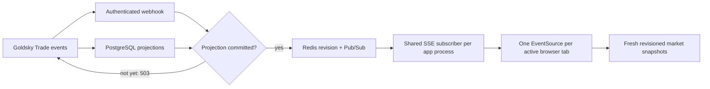

# Live market updates

The existing Goldsky pipeline now has a second destination for `camp_trades`:

`POST /api/webhooks/goldsky` requires `Authorization: Bearer <KORUM_GOLDSKY_WEBHOOK_SECRET>`.
The secret is server-only, at least 32 characters, and must match Goldsky's
`KORUM_STAGING_MARKET_WEBHOOK` httpauth secret (`secretKey: Authorization`,
`secretValue: Bearer <token>`). `REDIS_URL` must be configured on the app service.
The pipeline targets the existing staging app's public domain.

The endpoint validates the chain, addresses, hashes, operation and event ID,
accepts at most 100 rows/128 KiB, and waits up to eight PostgreSQL readiness checks.
It returns 503 if indexing or Redis is unavailable so Goldsky retries. It never
writes or fabricates blockchain trades in PostgreSQL. Insert/update notices wait
for the exact block hash and market metadata; deletes wait for that version to
be absent. Within one batch only the final operation for an event is retained.

Redis atomically deduplicates each event's latest operation/block hash (24-hour
retention), advances the market-cache revision, then publishes token addresses.
All replicas use the same namespace. An in-flight request on an old revision
cannot refill the new revision's cache. Live snapshot routes use `no-store` for
HTTP caching; shared Redis caching and request deduplication remain enabled.
`KORUM_CACHE_NAMESPACE` optionally isolates integration-test cache/broadcast keys;
leave it unset for the normal deployment.

`GET /api/markets/live?tokens=0x...&feed=1` uses SSE. Token subscriptions are limited
to 20; `feed=1` requests all trade notifications for the Explore ticker. There is
one Redis subscriber per process and one browser connection shared by both token
panels and the ticker. Connections have heartbeats, bounded buffers, a four-minute
lifetime and an opening-rate budget. Hidden tabs close the stream. Disconnecting
restores polling; reconnecting triggers fresh snapshots rather than claiming
lossless event replay. A periodic snapshot remains enabled even while connected.

The browser coalesces invalidations over 250 ms and refreshes only active queries.
This is a notification-driven snapshot design: notifications contain no prices or
wallet data, and PostgreSQL remains authoritative. It deliberately incurs one
snapshot fetch after delivery instead of displaying a trade before indexing.
The last candle uses incremental updates when earlier buckets are unchanged;
corrections or sliding windows replace the dataset while preserving the visible
range. The ticker reconciles deletions and corrected labels, caps its visible and
pending history, and drains bursts in batches every 150 ms.

## Rollout

1. Generate a random token and configure the same value in the app's
   `KORUM_GOLDSKY_WEBHOOK_SECRET` and Goldsky's httpauth secret. Never commit it.
2. Deploy the app before activating the webhook sink. Verify unauthorized requests
   return 401 and the SSE endpoint emits `ready` with Redis connected.
3. Validate then apply `goldsky/pipelines/korum-robinhood-testnet.yaml`. Keep the
   current pipeline/source names to preserve indexing checkpoints. Do not replay
   the full history merely to activate live delivery.
4. Verify all seven sinks and inspect a real indexed trade. No latency guarantee
   is inferred from the 250 ms batching interval; source lag still applies.

To disable live delivery, remove the webhook sink and apply the pipeline first;
then remove the app secret. Charts and ticker continue polling. No migration is
required. Redis Pub/Sub is transient; missed notifications are recovered by
snapshots, not replayed from a durable message log.

## Checks

- `node --experimental-strip-types scripts/check-market-live-protocol.mjs`
- Build first, then run `REDIS_URL=redis://127.0.0.1:16379 node --env-file=.env.local scripts/check-market-live.mjs` with a temporary Redis server.

The integration script starts two local Next instances on ports 3102/3103,
uses a unique Redis namespace, and removes only its own Redis keys afterward.
PostgreSQL access is read-only. The deletion fixture represents an absent event;
the insertion fixture verifies that an uncommitted trade returns 503. Neither
fixture is written to the real market tables.

## Staging verification — 2026-09-29

Railway deployment `42e6b242-7a42-4ede-a0f3-b19165c62087` reached `SUCCESS`.
Public checks confirmed webhook authentication (401 without credentials, 400 for
an authenticated invalid payload) and an SSE `ready` event with Redis connected.
Goldsky `korum-robinhood-testnet-indexer` is running with all seven sinks
acknowledging checkpoints, including `market_notifications_webhook`; persisted
source offsets were restored. The two-instance local integration check passed.
No new on-chain trade was submitted, so end-to-end live trade latency remains
unmeasured.
