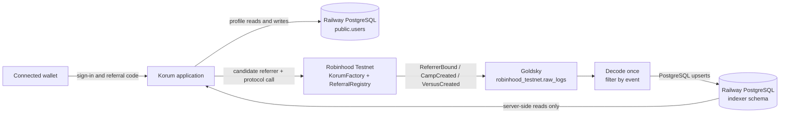

# Referral and Indexer Architecture

Status: accepted  
Last updated: 2026-09-12

## Purpose

This document records how Korum separates application identity, permanent referral state, and indexed read models. It is the reference for developers working on referral links, contract writes, Goldsky pipelines, profile metrics, or versus feeds.

## Decision

Korum uses three distinct data layers. They intentionally do not duplicate the same authority.

| Layer | Responsibility | Source of truth |
| --- | --- | --- |
| Railway PostgreSQL `public.users` | Wallet profiles and short shareable referral codes | Korum application |
| `ReferralRegistry` | Permanent `user -> referrer` binding used by the protocol | Smart contract |
| Railway PostgreSQL `indexer.*` | Queryable projections of contract events | Goldsky replaying on-chain events |

The application must never store a mutable `referred_by` relationship on `users`. Once a referral is bound, `ReferralRegistry.referrerOf(user)` is authoritative. The indexed PostgreSQL copy exists for frontend queries and analytics, not for contract correctness.

## End-to-end topology



There is no direct write from a contract to Railway. Contracts emit logs, Goldsky consumes those logs, SQL transforms build application-shaped rows, and PostgreSQL sinks write the rows into Railway. Likewise, the browser never connects to Railway or Goldsky directly.

## Referral-code ownership

`public.users` stores:

- one normalized EVM wallet;
- one immutable six-character, case-sensitive Base62 referral code;
- profile and authentication metadata.

The server generates the code with a cryptographically secure random generator on the wallet's first verified sign-in. PostgreSQL enforces uniqueness. If a collision occurs, the server generates another candidate and retries.

The short code is an application-level alias. Smart contracts never receive or interpret it. Before a contract write, the server resolves the code to its owner's EVM wallet.

## Referral link flow

A referral link may target any application page:

```text
https://korum.app/explore?ref=Ab3Xy9
```

The current flow is:

1. `proxy.ts` detects the `ref` query parameter on a page request.
2. It removes `ref` from the destination URL to avoid leaving attribution data in copied URLs, logs, and analytics.
3. `/api/referrals/capture` validates the code against `public.users`.
4. Invalid codes and a connected wallet's own code are ignored.
5. A valid code is stored for 30 days in an `HttpOnly`, `SameSite=Lax` cookie.
6. A short-lived server-confirmed notification is exposed through the header bell to tell the recipient that the referral is pending.
7. Once the user is authenticated, `/api/referrals/pending` resolves the code to the referrer's wallet.
8. The transaction UI passes that wallet as the `referrer` argument on the user's next eligible contract write.

The cookie is only pending attribution. It is not proof that a binding exists and must never be used to calculate or display authoritative referral rewards.

## First eligible contract write

The eligible entry points are:

- `KorumFactory.createVersus`;
- `KorumCore.buy`;
- `KorumCore.sell`;
- `KorumRouter.swap`.

For `buy`, `sell`, and `swap`, a new binding is attempted only when `recipient == msg.sender`. Passing a referrer when another recipient is used is a silent no-op and the UI must not claim that the user was bound.

`ReferralRegistry.bind(user, referrer)` is also a silent no-op when:

- `referrer == address(0)`;
- `referrer == user`;
- the user already has a referrer.

When a new binding succeeds, the registry emits `ReferrerBound(user, referrer, at)`. The binding is write-once and cannot be edited by the application, an administrator, or a later referral link.

## Cookie lifecycle

Do not clear the pending cookie merely because a transaction receipt has status `success`. A successful protocol transaction may still have skipped the binding.

After an eligible receipt is confirmed:

1. Decode `ReferrerBound` from the receipt.
2. If the expected user was bound, clear the cookie with `DELETE /api/referrals/pending`.
3. If no event was emitted, read `ReferralRegistry.referrerOf(user)`.
4. If the result is non-zero, clear the cookie because the registry is already authoritative, even if it contains a different pre-existing referrer.
5. If the result is zero, keep the cookie for a later eligible self-directed write.

The cookie should also remain when the transaction reverts or when `recipient != msg.sender`.

Clearing a confirmed attribution prevents stale UI, unnecessary PostgreSQL lookups, and accidental reuse when another wallet is connected in the same browser.

## Later contract interactions

The cookie is not needed after binding. Every later fee calculation reads the permanent registry value for the transaction recipient:

```solidity
referrer = ReferralRegistry.referrerOf(recipient);
```

After the registry returns a non-zero address, the frontend may pass `address(0)` as the write-time `referrer` candidate. Continuing to pass the original referrer is also safe because `bind` becomes a no-op, but passing zero makes it explicit that no new attribution is pending.

Post-graduation swaps must go through `KorumRouter`. Routing directly through the Uniswap PoolManager loses trader and referral attribution even when the registry contains a referrer.

## Versus creation write path

The `/create` route is the first complete protocol-write interface. Its Server Component reads any pending referral for the verified wallet session and passes that server-resolved value to the client form. The browser cannot provide an arbitrary referrer wallet through the form.

Frontend contract access is centralized in `app/lib/contracts/korum.ts`. This module imports the canonical ABIs from `contracts/abis/`, loads Robinhood Testnet addresses from `contracts/deployments/46630.json`, normalizes those addresses with Viem, and exports the shared chain, address, and ABI constants. Components must use this adapter instead of duplicating addresses or hand-written ABI fragments.

Before allowing publication, `CreateVersusForm` reads live protocol state through Wagmi:

- `KorumCore.configCount()` and `getConfig(configId)` select the latest active launch configuration;
- `KorumFactory.MIN_CREATOR_BUY_BPS()` and `MAX_CREATOR_BUY_BPS()` constrain each initial purchase;
- `KorumCore.quoteCreatorInitialBuy()` estimates each camp's purchase cost;
- the connected wallet's native balance is compared with the estimated total.

The form validates the debate metadata, distinct camp names and symbols, initial-purchase bounds, optional X handle, and acceptance of the Terms of Use. Camp image files are local previews only: the current application does not upload media. Each camp therefore requires a public `https://`, `ipfs://`, or `ar://` URI that can safely be stored on-chain.

Publication follows this sequence:

1. Require a connected, application-authenticated wallet and switch it to Robinhood Testnet when necessary.
2. Generate a cryptographically random `bytes32` salt and build the exact `VersusParams` payload, with the connected wallet as `creatorFeeRecipient`.
3. Resolve the candidate referrer from the pending server-validated attribution, or use `address(0)` when none exists.
4. Call `KorumFactory.previewCost(params)` immediately before submission so the attached native value is based on the final payload and current contract state.
5. Run `simulateContract` to surface a revert before prompting the wallet.
6. Submit `KorumFactory.createVersus(params, candidateReferrer)` with the quoted value and wait for one confirmation.
7. Decode `VersusCreated` from the receipt for immediate transaction feedback, then apply the referral cookie lifecycle described above.

Contract confirmation and read-model availability are separate milestones. A successful receipt proves creation on-chain; Goldsky subsequently consumes `CampCreated` and `VersusCreated` and projects them into Railway. The UI must tolerate indexing delay and must not treat a temporary missing database row as a failed contract transaction.

## Indexed read model

Goldsky writes only to the `indexer` PostgreSQL schema:

| Event | Destination table | Primary identity |
| --- | --- | --- |
| `ReferrerBound` | `indexer.referral_bindings` | `(chain_id, user_wallet)` |
| `VersusCreated` | `indexer.versuses` | `(chain_id, versus_id)` |
| `CampCreated` | `indexer.versus_camps` | `(chain_id, versus_id, side)` |

`indexer.referral_bindings` is useful for reverse lookups, referral counts, leaderboards, and historical API reads. It is not consulted by contracts and must not override a direct `referrerOf` read.

`indexer.versus_camps` deliberately has no foreign key to `indexer.versuses`. The factory emits both `CampCreated` events before `VersusCreated`, so each camp must be insertable before its parent projection exists.

Goldsky transforms must:

- exclude all blocks before the earliest deployment represented by their source;
- lowercase EVM addresses and transaction/block hashes;
- convert event timestamps to UTC `timestamptz` values;
- upsert on the declared primary keys so replays are idempotent;
- preserve Goldsky's `_gs_op` field so inserts, updates, deletes, and chain reorganizations propagate correctly;
- ingest both `CampCreated` events and `VersusCreated` without assuming sink write order.

The browser never connects directly to PostgreSQL. Server Components and Route Handlers read the indexed tables and map them to the frontend `Debate` contract.

### Frontend read path

`app/lib/db/debates.ts` is the server-only adapter between Railway's normalized indexer schema and the frontend `Debate` model. The Explore Server Component calls it directly, while browser-only consumers such as Watchlist and Analytics use `GET /api/debates`. Database credentials therefore remain on the server.

The query starts from `indexer.versuses` and uses inner joins for side `0` and side `1` in `indexer.versus_camps`. A Versus is intentionally hidden during the short interval where Goldsky has written only part of the three-event projection. Results are scoped to Robinhood Testnet (`chain_id = 46630`), ordered newest first, and capped server-side.

The adapter exposes on-chain metadata that already exists in the read model: Versus ID, title, description, category, socials, creator, creation time, camp names and symbols, token addresses, and normalized public media URLs. `ipfs://` and `ar://` media identifiers are translated to public gateways for the current image components.

Trading volume, liquidity, market capitalization, holder counts, trade counts, price changes, and price history are currently returned as neutral zero values. These facts are not emitted by `VersusCreated` or `CampCreated`, so the application must not manufacture them from fixture data. Populate them only after the corresponding trading events and aggregation strategy have been added to the Goldsky read model.

Live Railway data is the default application mode. The persisted `Mock data` control is an explicit development/demo override; API or database failures in live mode produce an empty/error state and never fall back silently to fixtures. The dynamic `/vs/[id]` page follows the same source selection so a live ID cannot accidentally open a fixture with the same numeric ID.

## Deployed Goldsky pipeline

The Robinhood Testnet indexer was deployed on 2026-09-12 with the following identity:

| Setting | Value |
| --- | --- |
| Goldsky project | `Korum` |
| Goldsky project ID | `project_cmjt6axh43c8t01u34dtr5a7v` |
| Pipeline | `korum-robinhood-testnet-indexer` |
| Pipeline definition | `goldsky/pipelines/korum-robinhood-testnet.yaml` |
| Network | Robinhood Chain Testnet (`chain_id = 46630`) |
| Dataset | `robinhood_testnet.raw_logs` version `1.1.0` |
| Mode | Streaming, with an initial historical phase |
| Resource size | `s` |
| PostgreSQL secret | `KORUM_STAGING_RAILWAY_POSTGRES` |
| Destination | Railway `staging` PostgreSQL, schema `indexer` |

The pipeline was initially observed in `Running` state. Treat that as deployment history, not a permanent guarantee; always query Goldsky for the current state.

### Source scope

The source reads raw logs only for the contracts that emit the three projections currently required by the application:

| Contract | Address | Deployment block | Events consumed |
| --- | --- | ---: | --- |
| `ReferralRegistry` | `0xe72f5f1d4c6793c67f962e2e8c36ee1f0750a24c` | `116108291` | `ReferrerBound` |
| `KorumFactory` | `0x18d70d9ca430747b81e6afb667abdc923b16b417` | `116108344` | `CampCreated`, `VersusCreated` |

Both contracts share one filtered source. Consequently, the filter begins at block `116108291`, the earlier of the two deployment blocks. The address condition prevents unrelated chain logs from reaching the decoder. Addresses and deployment blocks are canonically recorded in `contracts/deployments/46630.json`; a contract redeployment must update that file and the pipeline together.

The other deployed Korum contracts are intentionally absent from this source. Add them only when the application needs projections for their events. Reading every Korum log preemptively would increase cost and make the read model harder to own.

### Decode-once, fan-out pattern

`decoded_korum_events` calls `_gs_log_decode` once with the minimal ABI definitions for the three indexed events. Three downstream transforms then filter on `decoded.event_signature` and fan out into independent PostgreSQL sinks. This avoids decoding the same raw log three times while allowing each destination table to keep its own schema and primary key.

The full contract ABI files under `contracts/abis/` are canonical. The pipeline embeds only the event fragments required at runtime because Goldsky cannot read a local repository path. Whenever one of these event signatures changes, regenerate or manually update the embedded fragment, validate it against the canonical ABI, and redeploy the pipeline.

### Event-to-column mapping

Goldsky event parameters are one-indexed: the first Solidity parameter is `decoded.event_params[1]`.

| Event | Important parameter mapping | Destination |
| --- | --- | --- |
| `ReferrerBound(user, referrer, at)` | `1 -> user_wallet`, `2 -> referrer_wallet`, `3 -> bound_at` | `indexer.referral_bindings` |
| `VersusCreated(versusId, creator, configId, creatorFeeRecipient, tokenA, tokenB, createdAt, title, description, category, socialsJson)` | Parameters `1..11` map in the same order; the emitting address becomes `factory_address` | `indexer.versuses` |
| `CampCreated(versusId, token, side, name, symbol, uri, virtualEth, graduationEth, totalSupply)` | `1 -> versus_id`, `2 -> token_address`, `3 -> side`, `4..9 -> metadata and launch values` | `indexer.versus_camps` |

Every row also receives the constant `chain_id = 46630` plus the source `transaction_hash`, `block_hash`, `block_number`, and `log_index`. These fields make indexed data auditable back to the originating log.

### Type and normalization rules

- EVM addresses and hashes are lowercased before insertion because PostgreSQL format constraints require normalized lowercase hexadecimal values.
- `_gs_log_decode` exposes Solidity integer event parameters as decimal text. Every `uint256` and `uint128` destined for a PostgreSQL `NUMERIC` column must first pass through Goldsky's `to_u256()` transform. Selecting the raw text directly causes PostgreSQL to reject the sink insert with `column ... is of type numeric but expression is of type text`.
- Goldsky maps the resulting exact `U256` values into `NUMERIC(78, 0)` or `NUMERIC(39, 0)` columns. Do not cast these values to floating-point or 64-bit integers; either conversion could lose data or overflow.
- `configId` is safely cast to `BIGINT`, `side` to `SMALLINT`, and `log_index` to `INTEGER` because their Solidity/source ranges fit those PostgreSQL types.
- Solidity `uint64` event timestamps and the dataset block timestamp are converted from Unix seconds to UTC PostgreSQL timestamps.
- The transforms omit `ingested_at`; Railway PostgreSQL supplies it through `DEFAULT NOW()`.
- `_gs_op` is carried through every transform as Goldsky control metadata. It is not an application column.

### Upsert identities and ordering

The sink primary keys exactly match the database primary keys:

| Sink | PostgreSQL conflict identity |
| --- | --- |
| `referral_bindings_postgres` | `(chain_id, user_wallet)` |
| `versuses_postgres` | `(chain_id, versus_id)` |
| `versus_camps_postgres` | `(chain_id, versus_id, side)` |

This makes normal replay idempotent. The additional unique `(chain_id, transaction_hash, log_index)` constraints prevent the same on-chain event from being represented by two logical rows.

Do not add a foreign key from `versus_camps` to `versuses`: `KorumFactory` emits the two camps first, and the three sinks progress independently. APIs that require a complete versus should select the parent plus both sides and omit incomplete results until all three events have arrived.

## Credentials and network boundaries

The committed YAML contains only the Goldsky secret name. `KORUM_STAGING_RAILWAY_POSTGRES` is stored encrypted in the Goldsky `Korum` project and contains Railway's externally reachable PostgreSQL connection details. Never commit the secret value, paste it into documentation, or expose it through a `NEXT_PUBLIC_*` variable.

Connection rules by runtime:

| Consumer | Connection to use |
| --- | --- |
| Goldsky | Railway public PostgreSQL endpoint, because Goldsky runs outside Railway |
| Deployed Korum application | Railway private service reference such as `${{Postgres.DATABASE_URL}}` |
| Local developer tools | `DATABASE_URL` in `.env.local`, or a Railway tunnel |
| Browser | No database connection |

Renaming a Railway environment does not require a YAML change because the YAML references a Goldsky secret by name. If Railway rotates the password, port, host, or database, update the Goldsky secret in place and verify the running sinks. For production, prefer a dedicated PostgreSQL writer role restricted to the `indexer` schema rather than sharing an application-owner credential.

The application credential may read `indexer.*` and manage `public.users`; Goldsky should write only `indexer.*`. PostgreSQL permissions are the enforcement boundary. The schema naming convention alone is not a permission boundary.

## Checkpoints, backfill, and re-deployments

The pipeline is streaming. On its first deployment, Goldsky processed the bounded historical phase and then switched to the live Robinhood log stream. The initial historical scan found no matching events for the configured addresses, so all three tables started with zero chain-derived rows.

Goldsky checkpoints are tied to the pipeline name and source name. Preserve both `korum-robinhood-testnet-indexer` and `korum_logs` during ordinary YAML updates so processing resumes without replaying all history.

Changing an address filter does not by itself rewind an existing checkpoint. If a newly added contract already emitted historical events, use a deliberate backfill strategy: deploy a temporary bounded/backfill pipeline, or reset/recreate the relevant source only after evaluating duplicate and reorganization behavior. Never rename the pipeline or source casually; doing so can trigger a full replay.

The PostgreSQL primary keys make a replay idempotent for the current projections, but a reset is still an operational action: it creates load, may surface old malformed events, and must be monitored.

## Operations runbook

The current CLI is installed under `~/.goldsky/bin`. Ensure that directory appears before an older system installation in `PATH`, or invoke it explicitly.

Validate every change before applying it:

```bash
goldsky turbo validate goldsky/pipelines/korum-robinhood-testnet.yaml
goldsky turbo apply goldsky/pipelines/korum-robinhood-testnet.yaml
```

Committing the YAML does not update the running Goldsky pipeline. `turbo apply` is a separate external deployment step.

Check health and recent errors:

```bash
goldsky turbo list
goldsky turbo logs korum-robinhood-testnet-indexer --since 600 --tail 200 --timestamps
goldsky secret list
```

Run the transactional Railway schema smoke test locally:

```bash
node --env-file=.env.local scripts/check-indexer-db.mjs
```

The smoke test rolls its writes back. It verifies constraints and the expected versus/camp join, but it does not prove that Goldsky has observed a real contract event.

For an end-to-end staging test:

1. Execute a real `createVersus` transaction and, separately, a referral-eligible write with an unbound wallet.
2. Confirm the transaction receipts contain the expected events.
3. Watch Goldsky logs for decode or PostgreSQL sink errors.
4. Query all three `indexer` tables by chain ID and transaction hash.
5. Confirm the frontend reads the resulting versus only after both camps and the versus row exist.

When triaging failures, start with these boundaries:

| Symptom | First checks |
| --- | --- |
| Pipeline is not `Running` | `goldsky turbo list`, then recent pipeline logs |
| Authentication or connection failure | Goldsky secret exists; Railway public endpoint and credentials are current |
| Constraint violation | Address/hash normalization, event parameter order, numeric range, duplicate identity |
| PostgreSQL reports `numeric` versus `text` | Ensure decoded `uint128`/`uint256` fields use `to_u256()` before reaching the sink |
| Pipeline runs but rows are absent | Contract address, deployment block, exact event ABI/signature, receipt logs, checkpoint position |
| Rows exist but frontend is stale | Server-side query/cache behavior; do not blame or bypass the contract |
| Camps appear before the versus | Expected event/sink ordering; API should tolerate temporary incompleteness |

## Safe extension procedure

When adding a new indexed event:

1. Add or update its canonical ABI under `contracts/abis/`.
2. Record the emitting contract address and deployment block in `contracts/deployments/46630.json`.
3. Decide whether the event belongs in an existing table or a new migration-backed read model.
4. Apply the PostgreSQL migration before enabling the sink.
5. Add the address to the source filter and the minimal event ABI to the shared decoder.
6. Add a typed transform that preserves `_gs_op` and provenance fields.
7. Add a PostgreSQL sink whose key matches the table primary key.
8. Validate the YAML, review the full diff, and apply it to Goldsky.
9. Verify pipeline state, logs, and a real staging event.

Use a separate pipeline when a new chain needs an independent lifecycle or when its source/resource requirements differ materially. Multiple projections from the same Robinhood raw-log source should normally remain fan-out sinks in this pipeline.

## Failure and trust boundaries

- A database outage may prevent resolving a new short code, but it cannot alter an existing on-chain binding.
- Goldsky lag may delay frontend metrics, but it cannot change fee distribution.
- A cookie may be absent, expired, or manually modified. The server always validates its code against `users`, and the contract still enforces zero-address, self-referral, and write-once rules.
- An on-chain binding can exist for a wallet with no `users` row. Indexer tables therefore do not reference application users with foreign keys.
- The application must use the authenticated session wallet when resolving pending attribution; it must not trust a wallet address supplied in a browser request body.

## Implementation map

| Concern | Location |
| --- | --- |
| Referral-code creation and wallet upsert | `app/lib/db/users.ts` |
| Referral-code lookup | `app/lib/db/referrals.ts` |
| Shared code and cookie rules | `app/lib/referrals/constants.ts` |
| Pending referral resolution | `app/lib/referrals/pending.ts` |
| Global `?ref=` interception | `proxy.ts` |
| Referral validation and capture | `app/api/referrals/capture/route.ts` |
| Authenticated read and cookie clearing | `app/api/referrals/pending/route.ts` |
| Versus creation transaction UI | `app/create/CreateVersusForm.tsx` |
| Shared frontend chain, address, and ABI adapter | `app/lib/contracts/korum.ts` |
| Server-only indexed Versus reader and frontend mapping | `app/lib/db/debates.ts` |
| Browser-safe indexed Versus endpoint | `app/api/debates/route.ts` |
| Live Explore feed | `app/explore/page.tsx`, `app/components/explore/*` |
| Database read-model definition | `db/migrations/0002_create_indexer_read_model.sql` |
| Contract addresses and deployment blocks | `contracts/deployments/46630.json` |
| Canonical contract ABIs | `contracts/abis/*.json` |
| Deployed Goldsky pipeline definition | `goldsky/pipelines/korum-robinhood-testnet.yaml` |
| Indexer database smoke test | `scripts/check-indexer-db.mjs` |
| End-to-end referral check | `scripts/check-auth-flow.mjs` |

## Alternatives rejected

### Store `referred_by_user_id` on `users`

Rejected because it creates a second authority that can drift from the immutable registry and excludes on-chain wallets that never create an application profile.

### Use the EVM address as the public referral code

Rejected because it produces poor shareable links and unnecessarily exposes a long identifier in the user experience.

### Deterministically truncate or encode the wallet into six characters

Rejected because six Base62 characters cannot provide a collision-free mapping for the full EVM address space. Random generation plus a PostgreSQL unique constraint provides explicit collision handling.

### Treat the Goldsky table as the protocol authority

Rejected because indexing is asynchronous and replayable. Contract execution and fee distribution must depend only on `ReferralRegistry`.

## Contract-integration checklist

Before enabling real writes:

- load contract addresses and deployment blocks from environment configuration;
- generate ABIs from the contract artifacts rather than copying fragments manually;
- read `referrerOf(user)` before constructing the write;
- resolve a pending referral only when the registry currently returns zero;
- show an explicit confirmation before the irreversible first binding;
- pass the candidate referrer only on an eligible self-directed write;
- wait for the receipt and apply the cookie lifecycle described above;
- use `KorumRouter` for all post-graduation swaps;
- let Goldsky project `ReferrerBound` for the frontend without blocking transaction success on indexer freshness.
