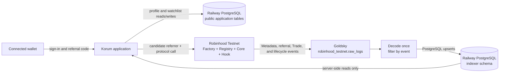

# Referral and Indexer Architecture

Status: accepted  
Last updated: 2026-09-14

## Purpose

This document records how Korum separates application identity, permanent referral state, and indexed read models. It is the reference for developers working on referral links, contract writes, Goldsky pipelines, profile metrics, or versus feeds.

## Decision

Korum uses three distinct data layers. They intentionally do not duplicate the same authority.

| Layer | Responsibility | Source of truth |
| --- | --- | --- |
| Railway PostgreSQL `public.users` and `public.user_watchlist` | Wallet profiles, editable usernames, short shareable referral codes, and user watchlists | Korum application |
| `ReferralRegistry` | Permanent `user -> referrer` binding used by the protocol | Smart contract |
| Railway PostgreSQL `indexer.*` | Queryable projections of contract events | Goldsky replaying on-chain events |

The application must never store a mutable `referred_by` relationship on `users`. Once a referral is bound, `ReferralRegistry.referrerOf(user)` is authoritative. The indexed PostgreSQL copy exists for frontend queries and analytics, not for contract correctness.

## End-to-end topology



There is no direct write from a contract to Railway. Contracts emit logs, Goldsky consumes those logs, SQL transforms build application-shaped rows, and PostgreSQL sinks write the rows into Railway. Likewise, the browser never connects to Railway or Goldsky directly.

## Referral-code ownership

`public.users` stores:

- one normalized EVM wallet;
- one immutable six-character, case-sensitive Base62 referral code;
- profile and authentication metadata.

The server generates the code with a cryptographically secure random generator on the wallet's first verified sign-in. PostgreSQL enforces uniqueness. If a collision occurs, the server generates another candidate and retries.

The short code is an application-level alias. Smart contracts never receive or interpret it. Before a contract write, the server resolves the code to its owner's EVM wallet.

## Referral link flow

A referral link may target any application page:

```text
https://korum.app/explore?ref=Ab3Xy9
```

The current flow is:

1. `proxy.ts` detects the `ref` query parameter on a page request.
2. It removes `ref` from the destination URL to avoid leaving attribution data in copied URLs, logs, and analytics.
3. `/api/referrals/capture` validates the code against `public.users`.
4. Invalid codes and a connected wallet's own code are ignored.
5. A valid code is stored for 30 days in an `HttpOnly`, `SameSite=Lax` cookie.
6. A short-lived server-confirmed notification is exposed through the header bell to tell the recipient that the referral is pending.
7. Once the user is authenticated, `/api/referrals/pending` resolves the code to the referrer's wallet.
8. The transaction UI passes that wallet as the `referrer` argument on the user's next eligible contract write.

The cookie is only pending attribution. It is not proof that a binding exists and must never be used to calculate or display authoritative referral rewards.

## First eligible contract write

The eligible entry points are:

- `KorumFactory.createVersus`;
- `KorumCore.buy`;
- `KorumCore.sell`;
- `KorumRouter.swap`.

For `buy`, `sell`, and `swap`, a new binding is attempted only when `recipient == msg.sender`. Passing a referrer when another recipient is used is a silent no-op and the UI must not claim that the user was bound.

`ReferralRegistry.bind(user, referrer)` is also a silent no-op when:

- `referrer == address(0)`;
- `referrer == user`;
- the user already has a referrer.

When a new binding succeeds, the registry emits `ReferrerBound(user, referrer, at)`. The binding is write-once and cannot be edited by the application, an administrator, or a later referral link.

## Cookie lifecycle

Do not clear the pending cookie merely because a transaction receipt has status `success`. A successful protocol transaction may still have skipped the binding.

After an eligible receipt is confirmed:

1. Decode `ReferrerBound` from the receipt.
2. If the expected user was bound, clear the cookie with `DELETE /api/referrals/pending`.
3. If no event was emitted, read `ReferralRegistry.referrerOf(user)`.
4. If the result is non-zero, clear the cookie because the registry is already authoritative, even if it contains a different pre-existing referrer.
5. If the result is zero, keep the cookie for a later eligible self-directed write.

The cookie should also remain when the transaction reverts or when `recipient != msg.sender`.

Clearing a confirmed attribution prevents stale UI, unnecessary PostgreSQL lookups, and accidental reuse when another wallet is connected in the same browser.

## Later contract interactions

The cookie is not needed after binding. Every later fee calculation reads the permanent registry value for the transaction recipient:

```solidity
referrer = ReferralRegistry.referrerOf(recipient);
```

After the registry returns a non-zero address, the frontend may pass `address(0)` as the write-time `referrer` candidate. Continuing to pass the original referrer is also safe because `bind` becomes a no-op, but passing zero makes it explicit that no new attribution is pending.

Post-graduation swaps must go through `KorumRouter`. Routing directly through the Uniswap PoolManager loses trader and referral attribution even when the registry contains a referrer.

## Versus creation write path

The `/create` route is the first complete protocol-write interface. Its Server Component reads any pending referral for the verified wallet session and passes that server-resolved value to the client form. The browser cannot provide an arbitrary referrer wallet through the form.

Frontend contract access is centralized in `app/lib/contracts/korum.ts`. This module imports the canonical ABIs from `contracts/abis/`, loads the deployment manifest selected by `NEXT_PUBLIC_KORUM_NETWORK`, normalizes its addresses with Viem, and exports the shared chain, address, and ABI constants. Components must use this adapter instead of duplicating addresses or hand-written ABI fragments.

Before allowing publication, `CreateVersusForm` reads live protocol state through Wagmi:

- `KorumCore.configCount()` and `getConfig(configId)` select the latest active launch configuration;
- `KorumFactory.MIN_CREATOR_BUY_BPS()` and `MAX_CREATOR_BUY_BPS()` constrain each initial purchase;
- `KorumCore.quoteCreatorInitialBuy()` estimates each camp's purchase cost;
- the connected wallet's native balance is compared with the estimated total.

The form validates the debate metadata, distinct camp names and symbols, initial-purchase bounds, optional X handle, and acceptance of the Terms of Use. Camp image files are local previews only: the current application does not upload media. Each camp therefore requires a public `https://`, `ipfs://`, or `ar://` URI that can safely be stored on-chain.

Publication follows this sequence:

1. Require a connected, application-authenticated wallet and switch it to the configured Korum chain when necessary.
2. Generate a cryptographically random `bytes32` salt and build the exact `VersusParams` payload, with the connected wallet as `creatorFeeRecipient`.
3. Resolve the candidate referrer from the pending server-validated attribution, or use `address(0)` when none exists.
4. Call `KorumFactory.previewCost(params)` immediately before submission so the attached native value is based on the final payload and current contract state.
5. Run `simulateContract` to surface a revert before prompting the wallet.
6. Submit `KorumFactory.createVersus(params, candidateReferrer)` with the quoted value and wait for one confirmation.
7. Decode `VersusCreated` from the receipt for immediate transaction feedback, then apply the referral cookie lifecycle described above.

Contract confirmation and read-model availability are separate milestones. A successful receipt proves creation on-chain; Goldsky subsequently consumes `CampCreated` and `VersusCreated` and projects them into Railway. The UI must tolerate indexing delay and must not treat a temporary missing database row as a failed contract transaction.

## Trading write path

Both `/vs/[id]` and `/explore` delegate contract interaction to `app/components/TokenTradePanel.tsx`. On Explore, each card keeps the interaction inline: the camp selector chooses the token, and Buy or Sell expands the compact trading controls directly inside that card. No overlay or route change is involved. Railway supplies the token address and display metadata, while every price-sensitive value is read from the configured Korum chain at interaction time. Indexed rows are discovery data, not transaction authority.

The panel reads:

- the connected wallet's native ETH balance;
- `VersusToken.decimals()`, `balanceOf(wallet)`, and `allowance(wallet, spender)`;
- `KorumCore.getCurve(token)` to select the current venue;
- `KorumCore.getConfig(curve.configId)` when the token has graduated and its pool key must be reconstructed.

The curve status controls routing:

| Status | Frontend behavior |
| --- | --- |
| `NONE (0)` | Reject the token as non-tradable. |
| `TRADING (1)` | Quote and trade through `KorumCore`. |
| `GRADUATING (2)` | Disable both actions until graduation finishes. |
| `LIVE (3)` | Reconstruct the pool key and trade through `KorumRouter`. |

On the bonding curve, buys call `quoteBuy(token, ethIn)` and sells call `quoteSell(token, tokenAmount)`. The displayed output and fee come directly from those views. A capped buy may return `ethAccepted < ethIn`; the difference is shown as an automatic refund, while the transaction still attaches the original input expected by `buy`.

The pool venue has no Korum quote view. The frontend therefore performs a read-only simulation of `KorumRouter.swap` with `minAmountOut = 0` to obtain the router's exact returned output, including the hook behavior. Pool sales require the token allowance before this simulation can execute because the simulated router performs `transferFrom`; when necessary, the UI confirms the ERC-20 approval first, then simulates and submits the sale.

Every trade derives `minAmountOut` from a fresh quote immediately before submission and applies a 1% slippage limit. It then simulates the final call with that minimum before opening the wallet. Curve sales approve `KorumCore`; pool sales approve `KorumRouter`. Pool buys attach native ETH exactly equal to `amountIn`, and all trades use the connected wallet as both caller and recipient.

The candidate referrer resolved from the pending referral cookie is passed to `buy`, `sell`, or `swap`. After the final receipt succeeds, the frontend reads `ReferralRegistry.referrerOf(wallet)` and clears the cookie only when a permanent non-zero binding is confirmed. Balances, allowance, and curve status are refreshed after confirmation.

The component never writes trading results to Railway. Goldsky independently projects confirmed `Trade` events into the historical read model. Wallet balances, live curve status, and the immediately simulated quote remain authoritative for submitting a transaction; the indexed projection is authoritative only for historical charts and aggregates.

## Market-data architecture

Korum stores the protocol's trade events rather than periodic price snapshots. This is viable because every confirmed trade is an immutable, auditable market fact and the event already carries the post-trade state required by the UI. Goldsky listens to the identical `Trade` signature on both emitters:

| Venue | Emitter | Stored value |
| --- | --- | --- |
| Pre-bonding curve | `KorumCore` | `venue = 0`, exposed by APIs as `"curve"` |
| Graduated pool | `KorumHook` | `venue = 1`, exposed by APIs as `"pool"` |

The venue must never be inferred from time or contract status. Keeping the event field allows a single continuous price history across graduation while retaining the boundary between the two execution mechanisms.

`Trade.sqrtPriceX96After` uses the protocol's ETH-as-currency0 convention. The server derives the token price in ETH with exact integer arithmetic:

```text
tokenPriceWad = (2^192 × 10^18) / sqrtPriceX96After²
```

The application does not ask Alchemy to rediscover protocol trades. Goldsky provides the exhaustive replayable history and Railway provides aggregation and pagination. Alchemy supplies the independent ETH/USD quote through its Prices API. The response keeps `quoteSymbol: "ETH"` and `quoteUsd` separate from every ETH-denominated market value so clients can reproduce or update the conversion. If `ALCHEMY_API_KEY` is absent or Alchemy is temporarily unavailable, the API returns `quoteUsd: null` and the frontend labels values in ETH instead of silently applying a stale or fabricated USD rate.

The internal endpoints deliberately follow the supplied market API shape:

```text
GET /api/markets/:token/chart?range=1h|1d|7d|30d|180d
GET /api/markets/:token/trades?limit=1..250
GET /api/markets/trades?limit=1..100
```

Chart points contain Unix time, token price in ETH, block number, ETH volume, and trade count. Token and global recent-trade responses contain normalized token/ETH amounts and preserve `venue: "curve" | "pool"`. The global feed also joins each event to its camp symbol and Versus ID. All endpoints are server-side Railway reads; no database credential reaches the browser.

### Network selection and RPC fallback

`NEXT_PUBLIC_KORUM_NETWORK` is the single build-time selector for the application protocol network. Allowed values are `testnet` and `mainnet`; omitting it defaults to `testnet`. The selection controls:

- the only chain offered by RainbowKit;
- every contract read, simulation, and write through `KORUM_CHAIN`;
- the deployment manifest (`46630.json` or `4663.json`);
- the `chain_id` predicate used by Railway market, Versus, and watchlist reads;
- explorer links shown after transactions.

This selector is intentionally independent from `NODE_ENV`. A staging deployment may run an optimized production build while still targeting testnet. Because `NEXT_PUBLIC_*` values are embedded during `next build`, changing the network requires a rebuild and redeployment.

The HTTP transport uses a Viem fallback pair:

1. the official public RPC declared by the active Robinhood chain;
2. same-origin `POST /api/rpc`, which forwards supported read-only JSON-RPC methods to Alchemy.

The second hop keeps `ALCHEMY_API_KEY` and `KORUM_ALCHEMY_RPC_URL` server-only. The proxy rejects cross-origin requests, oversized payloads, large batches, malformed JSON-RPC, and write or broadcast methods. It is a resilience path for contract reads and receipt polling, not an alternative trade indexer and not the source of `quoteUsd`. `quoteUsd` still comes from the separate Alchemy Prices API.

On testnet, the proxy derives the Robinhood Testnet Alchemy endpoint from `ALCHEMY_API_KEY`. `KORUM_ALCHEMY_RPC_URL` is an optional explicit server-only override and must be set to the private mainnet endpoint when mainnet is enabled. Never rename either secret with a `NEXT_PUBLIC_` prefix.

The committed `contracts/deployments/4663.json` manifest deliberately contains no addresses. Selecting `mainnet` fails fast until that file is completed, preventing testnet addresses from being used on mainnet. Mainnet activation therefore requires all of the following as one release:

1. populate and verify every address and deployment block in `4663.json`;
2. deploy a chain-4663 Goldsky pipeline and backfill its Railway rows;
3. configure `NEXT_PUBLIC_KORUM_NETWORK=mainnet` and the mainnet private RPC URL in the production Railway environment;
4. rebuild the application and run creation, trading, referral, explorer, and indexed-read smoke tests.

### Curve state, market cap, and adjusted FDV

`indexer.camp_market_state` reconstructs the latest camp state without replaying curve arithmetic in the frontend:

- the latest trade from either venue supplies the current `sqrtPriceX96After` and cumulative volume;
- the latest `venue = 0` trade permanently preserves the final pre-bonding `realEthAfter` and `tokenReserveAfter`, even after pool trades begin;
- `GraduationPending`, `Graduated`, and `CurveReopened` establish status and whether graduation was disabled;
- `Graduated.tokenResidual` records the exact amount sent to the permanent locker.

Before graduation, circulating supply is `totalSupply - tokenReserveAfter`. The projected structurally locked residual is calculated from each camp's emitted configuration as:

```text
projectedResidual = floor(totalSupply × virtualEth² / (virtualEth + graduationEth)²)
```

Before graduation, the displayed market cap uses the conventional circulating definition:

```text
marketCap = currentPrice × (totalSupply - tokenReserveAfter)
```

`currentPrice` comes from `sqrtPriceX96After` and therefore already reflects `virtualEth + realEth` in the bonding-curve reserve. The virtual ETH influences the price but is not real liquidity, circulating supply, or capital contributed by traders, so the frontend does not add it to market cap. The separate **Adjusted FDV** applies that same current price to `adjustedFdvSupply`; it describes the broader protocol-adjusted valuation without relabelling it as market cap.

After graduation, both market cap and Adjusted FDV use `totalSupply - Graduated.tokenResidual`. With the production configuration this is 91.84% of supply, not 100%; the remaining 8.16% is structurally locked. The exact event value takes precedence over the closed-form projection. A future live integrity check may compare it with `VersusToken.balanceOf(LiquidityLocker)`, but the indexer's historical computation must not substitute a hard-coded percentage.

## Database-backed watchlist and notifications

The watchlist is user-owned application data in Railway PostgreSQL, not an indexed blockchain fact. `public.user_watchlist` binds the authenticated `users.id` to `(chain_id, versus_id)`, with a composite primary key preventing duplicates and `ON DELETE CASCADE` removing preferences when a user is deleted. It intentionally has no foreign key to `indexer.versuses`: a Goldsky reindex or temporary projection removal must not erase the user's preference.

`/api/watchlist` is the only browser-facing data boundary:

- `GET` returns the authenticated wallet user's Versus IDs and their complete joined `indexer.versuses`/`indexer.versus_camps` projections for the configured chain;
- `POST` verifies that the Versus exists in the Goldsky read model before inserting it;
- `DELETE` removes the selected ID idempotently;
- every operation requires the signed wallet session, and mutations enforce same-origin requests.

`useWatchlist()` loads both membership and display data from that API and no longer reads or writes watchlist data in `localStorage`. The Watchlist page and Profile watchlist tab never resolve stored IDs against mock fixtures, preventing collisions between fixture IDs and on-chain Versus IDs. Mutations update mounted components optimistically, revert on API failure, and trigger a database refresh in other tabs through `BroadcastChannel`. Consequently, the watchlist follows the wallet across browsers and devices once that wallet authenticates.

The star on an Explore card or table row and the star on `/vs/[id]` use the same database-backed toggle. Selecting an empty star adds the Versus; selecting its filled state removes it. After the server confirms either mutation, a `watchlist` notification is published to the shared header bell. Notification presentation history remains a browser UI concern, capped at ten entries under `korum-notifications-v1`; it is not the source of truth for watchlist membership.

## Indexed read model

Goldsky writes only to the `indexer` PostgreSQL schema:

| Event | Destination table | Primary identity |
| --- | --- | --- |
| `ReferrerBound` | `indexer.referral_bindings` | `(chain_id, user_wallet)` |
| `VersusCreated` | `indexer.versuses` | `(chain_id, versus_id)` |
| `CampCreated` | `indexer.versus_camps` | `(chain_id, versus_id, side)` |
| `Trade` | `indexer.camp_trades` | `(chain_id, transaction_hash, log_index)` |
| `GraduationPending`, `Graduated`, `CurveReopened` | `indexer.camp_curve_lifecycle` | `(chain_id, transaction_hash, log_index)` |
| `Graduated` | `indexer.camp_graduations` | `(chain_id, token_address)` |

`indexer.referral_bindings` is useful for reverse lookups, referral counts, leaderboards, and historical API reads. It is not consulted by contracts and must not override a direct `referrerOf` read.

`indexer.versus_camps` deliberately has no foreign key to `indexer.versuses`. The factory emits both `CampCreated` events before `VersusCreated`, so each camp must be insertable before its parent projection exists.

Goldsky transforms must:

- exclude all blocks before the earliest deployment represented by their source;
- lowercase EVM addresses and transaction/block hashes;
- convert event timestamps to UTC `timestamptz` values;
- upsert on the declared primary keys so replays are idempotent;
- preserve Goldsky's `_gs_op` field so inserts, updates, deletes, and chain reorganizations propagate correctly;
- ingest both `CampCreated` events and `VersusCreated` without assuming sink write order.

The browser never connects directly to PostgreSQL. Server Components and Route Handlers read the indexed tables and map them to the frontend `Debate` contract.

### Frontend read path

`app/lib/db/debates.ts` is the server-only adapter between Railway's normalized indexer schema and the frontend `Debate` model. The Explore Server Component calls it directly, while browser-only consumers such as Watchlist and Analytics use `GET /api/debates`. Database credentials therefore remain on the server.

The query starts from `indexer.versuses` and uses inner joins for side `0` and side `1` in `indexer.versus_camps`. A Versus is intentionally hidden during the short interval where Goldsky has written only part of the three-event projection. Results are scoped to the active `KORUM_CHAIN_ID`, ordered newest first, and capped server-side.

The adapter exposes on-chain metadata plus the market view: current price, 24-hour volume/trades, distinct traders, curve progress, circulating and locked supply, circulating market cap, adjusted FDV, and recent price history. Explore's `Traders` count comes from distinct non-zero `Trade.trader` addresses across both camps; per-token table rows use the corresponding camp count. Holder counts and liquidity remain absent until their own authoritative projections exist and never override trader counts. `ipfs://` and `ar://` media identifiers are translated to public gateways for the current image components.

Live Railway data is the default application mode. The persisted `Mock data` control is an explicit development/demo override; API or database failures in live mode produce an empty/error state and never fall back silently to fixtures. The dynamic `/vs/[id]` page follows the same source selection so a live ID cannot accidentally open a fixture with the same numeric ID.

### Shared cache and RPC rate limiting

Railway Redis is a disposable performance layer in front of PostgreSQL and Alchemy. PostgreSQL remains authoritative for users, watchlists, Versus projections, and indexed trades; Alchemy remains authoritative for the ETH/USD response it returns. Losing or flushing Redis must only increase source traffic temporarily and must never lose application data.

The `staging` environment contains one private service named `Redis`. The web service receives `REDIS_URL` through the Railway reference `${{Redis.REDIS_URL}}`; Redis has no browser-facing endpoint. `app/lib/cache/redis.ts` creates one lazy `ioredis` client per Next.js process. Multiple web replicas therefore keep separate client connections but share the same cached keys. Local development may omit `REDIS_URL`, and every cache operation fails open to its PostgreSQL or Alchemy loader after a short timeout. A five-second circuit breaker prevents a Redis outage from adding that timeout to every application request.

All keys use the versioned `korum:v1:<network>:` namespace. Including `testnet` or `mainnet` prevents a network switch from returning values generated from the other chain. Current entries and TTLs are:

| Data | Key suffix | TTL |
| --- | --- | ---: |
| ETH/USD quote | `quote:eth-usd` | 60 seconds |
| Explore and public Versus list | `debates:list:<limit>` | 15 seconds |
| Versus detail | `debates:detail:<versusId>` | 15 seconds |
| Recent token trades | `market:trades:<token>:<limit>` | 5 seconds |
| Global recent-trade ticker | `market:recent-trades:<limit>` | 5 seconds |
| 1-hour chart | `market:chart:<token>:1h` | 5 seconds |
| 1-day chart | `market:chart:<token>:1d` | 15 seconds |
| 7-day chart | `market:chart:<token>:7d` | 30 seconds |
| 30-day chart | `market:chart:<token>:30d` | 60 seconds |
| 180-day chart | `market:chart:<token>:180d` | 300 seconds |

The quote retains a small per-process promise cache as an L1 deduplicator and uses Redis as the replica-shared L2 cache. Other cached loaders also deduplicate simultaneous misses inside one process. Public market Route Handlers publish matching short `Cache-Control` and `stale-while-revalidate` directives. Authentication, profile, referral, notification, and watchlist endpoints remain private and `no-store`; their PostgreSQL records are never replaced by cached values.

Public Versus and market API responses expose `X-Korum-Cache` (`HIT`, `MISS`, `DEDUPED`, or `BYPASS`) and `X-Korum-Cache-Layer` (`redis`, `memory`, or `postgres`) for operational diagnostics in browser developer tools. `MISS` means Redis was reachable but did not contain the key, while `BYPASS` means Redis was not configured or temporarily unavailable and the authoritative loader was used directly. These headers describe the server-side request that originally produced the response; when browser developer tools show `(memory cache)` or `(disk cache)`, the browser may be replaying those original headers without contacting the server again.

Goldsky writes PostgreSQL directly and does not notify the web process, so indexed market caches expire by TTL rather than explicit invalidation. A confirmed trade may consequently take the Goldsky indexing delay plus at most the relevant short TTL to appear. The application must continue distinguishing wallet receipt confirmation from read-model availability.

### Reactive public market reads

TanStack Query supplies the browser-side refresh layer and reuses the `QueryClient` already mounted for Wagmi. Explore's card list and Hot Trending section share the same `indexed-debates` key, so rendering both does not duplicate the network request. Analytics consumes that same query. `/vs/[id]` uses the dedicated `GET /api/debates/[id]` snapshot.

Refresh intervals align with the Redis TTLs:

| Visible surface | Browser interval |
| --- | ---: |
| Explore, Analytics, and Versus detail metrics | 15 seconds |
| Open Activity tab | 5 seconds |
| Explore buy/sell ticker | 5 seconds |
| 1-hour chart | 5 seconds |
| 1-day chart | 15 seconds |
| 7-day chart | 30 seconds |
| 30-day chart | 60 seconds |
| 180-day chart | 300 seconds |

Intervals stop while the browser tab is hidden and refresh immediately when it regains focus. The Activity query exists only while its tab is mounted. A confirmed buy or sell invalidates the active list, detail, chart, and trade queries immediately; normal polling then catches the Goldsky projection if the receipt has not yet reached Railway. These refreshes call only the cache-backed Next.js endpoints. They do not issue per-user blockchain RPC requests for market cap, volume, trade count, trader count, charts, or activity.

The Explore ticker polls the global recent-trade endpoint but does not render a returned batch at once. It records already-seen event IDs, orders unseen events chronologically in a bounded browser queue, and reveals one item every 1.1 seconds with the existing buy/sell animation. Initial history is rendered without arrival animation. A WebSocket is intentionally unnecessary at the current scale: Goldsky writes PostgreSQL rather than publishing directly to the browser, while a five-second Redis-backed poll provides adequate freshness, simpler recovery, and no persistent connection infrastructure. WebSocket or server-sent events become relevant only if event volume or latency requirements exceed this bounded polling model.

`POST /api/rpc` uses Redis for a fixed-window client budget shared by all web replicas. Client network addresses are hashed before becoming key material, and each JSON-RPC call in a batch consumes one unit. `KORUM_RPC_RATE_LIMIT` defaults to 300 units per `KORUM_RPC_RATE_WINDOW_SECONDS`, which defaults to 60 seconds. An exceeded budget returns `429` with `Retry-After`; if Redis is absent or temporarily unavailable, a bounded per-process limiter preserves basic protection without making the private RPC fallback unavailable.

## Deployed Goldsky pipeline

The Robinhood Testnet indexer was deployed on 2026-09-12 with the following identity:

| Setting | Value |
| --- | --- |
| Goldsky project | `Korum` |
| Goldsky project ID | `project_cmjt6axh43c8t01u34dtr5a7v` |
| Pipeline | `korum-robinhood-testnet-indexer` |
| Pipeline definition | `goldsky/pipelines/korum-robinhood-testnet.yaml` |
| Network | Robinhood Chain Testnet (`chain_id = 46630`) |
| Dataset | `robinhood_testnet.raw_logs` version `1.1.0` |
| Mode | Streaming, with an initial historical phase |
| Resource size | `s` |
| PostgreSQL secret | `KORUM_STAGING_RAILWAY_POSTGRES` |
| Destination | Railway `staging` PostgreSQL, schema `indexer` |

The pipeline was initially observed in `Running` state. Treat that as deployment history, not a permanent guarantee; always query Goldsky for the current state.

### Source scope

The source reads raw logs only for the contracts that emit the current projections:

| Contract | Address | Deployment block | Events consumed |
| --- | --- | ---: | --- |
| `ReferralRegistry` | `0xe72f5f1d4c6793c67f962e2e8c36ee1f0750a24c` | `116108291` | `ReferrerBound` |
| `KorumFactory` | `0x18d70d9ca430747b81e6afb667abdc923b16b417` | `116108344` | `CampCreated`, `VersusCreated` |
| `KorumCore` | `0x08e1f34e0fb10a0339ecba8cba2021ea2bb1171e` | `116108373` | `Trade`, `GraduationPending`, `Graduated`, `CurveReopened` |
| `KorumHook` | `0x63bab3ba5bdfc46d65fcaf3beacf8ee94438e0cc` | `116108400` | `Trade` |

All four contracts share one filtered source. Consequently, the filter begins at block `116108291`, the earliest relevant deployment block. The address condition prevents unrelated chain logs from reaching the decoder. Addresses and deployment blocks are canonically recorded in `contracts/deployments/46630.json`; a contract redeployment must update that file and the pipeline together.

### Decode-once, fan-out pattern

`decoded_korum_events` calls `_gs_log_decode` once with the minimal ABI definitions for all indexed events. Downstream transforms filter on `decoded.event_signature` and fan out into independent PostgreSQL sinks. The three lifecycle transforms are combined with `UNION ALL`; they are never deduplicated or reordered outside `(block_number, log_index)`.

The full contract ABI files under `contracts/abis/` are canonical. The pipeline embeds only the event fragments required at runtime because Goldsky cannot read a local repository path. Whenever one of these event signatures changes, regenerate or manually update the embedded fragment, validate it against the canonical ABI, and redeploy the pipeline.

### Event-to-column mapping

Goldsky event parameters are one-indexed: the first Solidity parameter is `decoded.event_params[1]`.

| Event | Important parameter mapping | Destination |
| --- | --- | --- |
| `ReferrerBound(user, referrer, at)` | `1 -> user_wallet`, `2 -> referrer_wallet`, `3 -> bound_at` | `indexer.referral_bindings` |
| `VersusCreated(versusId, creator, configId, creatorFeeRecipient, tokenA, tokenB, createdAt, title, description, category, socialsJson)` | Parameters `1..11` map in the same order; the emitting address becomes `factory_address` | `indexer.versuses` |
| `CampCreated(versusId, token, side, name, symbol, uri, virtualEth, graduationEth, totalSupply)` | `1 -> versus_id`, `2 -> token_address`, `3 -> side`, `4..9 -> metadata and launch values` | `indexer.versus_camps` |
| `Trade(token, trader, referrer, venue, …)` | `1 -> token_address`, `2 -> trader_address`, `3 -> referrer_address`, `4 -> venue`, and all post-trade values through parameter `19` | `indexer.camp_trades` |
| Curve lifecycle events | Token and event timestamp plus explicit status derived from the event signature | `indexer.camp_curve_lifecycle` |
| `Graduated(token, poolId, …, tokenResidual, at)` | Exact pool launch values and structurally locked residual | `indexer.camp_graduations` |

Every row also receives the constant `chain_id = 46630` plus the source `transaction_hash`, `block_hash`, `block_number`, and `log_index`. These fields make indexed data auditable back to the originating log.

### Type and normalization rules

- EVM addresses and hashes are lowercased before insertion because PostgreSQL format constraints require normalized lowercase hexadecimal values.
- `_gs_log_decode` exposes Solidity integer event parameters as decimal text. Every `uint256` and `uint128` destined for a PostgreSQL `NUMERIC` column must first pass through Goldsky's `to_u256()` transform. Selecting the raw text directly causes PostgreSQL to reject the sink insert with `column ... is of type numeric but expression is of type text`.
- Goldsky maps the resulting exact `U256` values into `NUMERIC(78, 0)` or `NUMERIC(39, 0)` columns. Do not cast these values to floating-point or 64-bit integers; either conversion could lose data or overflow.
- `configId` is safely cast to `BIGINT`, `side` to `SMALLINT`, and `log_index` to `INTEGER` because their Solidity/source ranges fit those PostgreSQL types.
- Solidity `uint64` event timestamps and the dataset block timestamp are converted from Unix seconds to UTC PostgreSQL timestamps.
- The transforms omit `ingested_at`; Railway PostgreSQL supplies it through `DEFAULT NOW()`.
- `_gs_op` is carried through every transform as Goldsky control metadata. It is not an application column.

### Upsert identities and ordering

The sink primary keys exactly match the database primary keys:

| Sink | PostgreSQL conflict identity |
| --- | --- |
| `referral_bindings_postgres` | `(chain_id, user_wallet)` |
| `versuses_postgres` | `(chain_id, versus_id)` |
| `versus_camps_postgres` | `(chain_id, versus_id, side)` |
| `camp_trades_postgres` | `(chain_id, transaction_hash, log_index)` |
| `camp_curve_lifecycle_postgres` | `(chain_id, transaction_hash, log_index)` |
| `camp_graduations_postgres` | `(chain_id, token_address)` |

This makes normal replay idempotent. The additional unique `(chain_id, transaction_hash, log_index)` constraints prevent the same on-chain event from being represented by two logical rows.

Do not add a foreign key from `versus_camps` to `versuses`: `KorumFactory` emits the two camps first, and those sinks progress independently. APIs that require a complete versus should select the parent plus both sides and omit incomplete results until all three creation events have arrived.

## Credentials and network boundaries

The committed YAML contains only the Goldsky secret name. `KORUM_STAGING_RAILWAY_POSTGRES` is stored encrypted in the Goldsky `Korum` project and contains Railway's externally reachable PostgreSQL connection details. Never commit the secret value, paste it into documentation, or expose it through a `NEXT_PUBLIC_*` variable.

Connection rules by runtime:

| Consumer | Connection to use |
| --- | --- |
| Goldsky | Railway public PostgreSQL endpoint, because Goldsky runs outside Railway |
| Deployed Korum application | Railway private service reference such as `${{Postgres.DATABASE_URL}}` |
| Deployed Korum cache client | Railway private service reference `${{Redis.REDIS_URL}}` |
| Local developer tools | `DATABASE_URL` in `.env.local`, or a Railway tunnel |
| Browser | No PostgreSQL or Redis connection |

RPC credentials follow the same boundary: browsers call the official public Robinhood endpoint and the same-origin fallback route; only the application server calls the credentialed Alchemy endpoint.

Renaming a Railway environment does not require a YAML change because the YAML references a Goldsky secret by name. If Railway rotates the password, port, host, or database, update the Goldsky secret in place and verify the running sinks. For production, prefer a dedicated PostgreSQL writer role restricted to the `indexer` schema rather than sharing an application-owner credential.

The application credential may read `indexer.*` and manage `public.users` plus `public.user_watchlist`; Goldsky should write only `indexer.*`. PostgreSQL permissions are the enforcement boundary. The schema naming convention alone is not a permission boundary.

## Checkpoints, backfill, and re-deployments

The pipeline is streaming. On its first deployment, Goldsky processed the bounded historical phase and then switched to the live Robinhood log stream. The market extension performs one deliberate replay from the earliest relevant deployment block so historical Core and Hook trades are not omitted.

Goldsky checkpoints are tied to the pipeline name and source name. The market extension deliberately renamed the source to `korum_protocol_logs_v2` once so Core and Hook history would be backfilled after expanding the address filter. Preserve both `korum-robinhood-testnet-indexer` and `korum_protocol_logs_v2` during ordinary future YAML updates so processing resumes without replaying all history.

Changing an address filter does not by itself rewind an existing checkpoint. If a newly added contract already emitted historical events, use a deliberate backfill strategy: deploy a temporary bounded/backfill pipeline, or reset/recreate the relevant source only after evaluating duplicate and reorganization behavior. Never rename the pipeline or source casually; doing so can trigger a full replay.

The PostgreSQL primary keys make this deliberate replay idempotent for existing projections, while event provenance keys prevent duplicate trades. A reset is still an operational action: it creates load, may surface old malformed events, and must be monitored.

## Operations runbook

The current CLI is installed under `~/.goldsky/bin`. Ensure that directory appears before an older system installation in `PATH`, or invoke it explicitly.

Validate every change before applying it:

```bash
goldsky turbo validate goldsky/pipelines/korum-robinhood-testnet.yaml
goldsky turbo apply goldsky/pipelines/korum-robinhood-testnet.yaml
```

Committing the YAML does not update the running Goldsky pipeline. `turbo apply` is a separate external deployment step.

Check health and recent errors:

```bash
goldsky turbo list
goldsky turbo logs korum-robinhood-testnet-indexer --since 600 --tail 200 --timestamps
goldsky secret list
```

Run the transactional Railway schema smoke test locally:

```bash
node --env-file=.env.local scripts/check-indexer-db.mjs
node --env-file=.env.local scripts/check-watchlist-db.mjs
```

The smoke test rolls its writes back. It verifies constraints and the expected versus/camp join, but it does not prove that Goldsky has observed a real contract event.

For an end-to-end staging test:

1. Execute a real `createVersus` transaction and, separately, a referral-eligible write with an unbound wallet.
2. Confirm the transaction receipts contain the expected events.
3. Watch Goldsky logs for decode or PostgreSQL sink errors.
4. Query the relevant `indexer` creation, trade, lifecycle, and graduation tables by chain ID and transaction hash.
5. Confirm the frontend reads the resulting versus only after both camps and the versus row exist.

When triaging failures, start with these boundaries:

| Symptom | First checks |
| --- | --- |
| Pipeline is not `Running` | `goldsky turbo list`, then recent pipeline logs |
| Authentication or connection failure | Goldsky secret exists; Railway public endpoint and credentials are current |
| Constraint violation | Address/hash normalization, event parameter order, numeric range, duplicate identity |
| PostgreSQL reports `numeric` versus `text` | Ensure decoded `uint128`/`uint256` fields use `to_u256()` before reaching the sink |
| Pipeline runs but rows are absent | Contract address, deployment block, exact event ABI/signature, receipt logs, checkpoint position |
| Rows exist but frontend is stale | Server-side query/cache behavior; do not blame or bypass the contract |
| Camps appear before the versus | Expected event/sink ordering; API should tolerate temporary incompleteness |

## Safe extension procedure

When adding a new indexed event:

1. Add or update its canonical ABI under `contracts/abis/`.
2. Record the emitting contract address and deployment block in the manifest matching the target chain ID.
3. Decide whether the event belongs in an existing table or a new migration-backed read model.
4. Apply the PostgreSQL migration before enabling the sink.
5. Add the address to the source filter and the minimal event ABI to the shared decoder.
6. Add a typed transform that preserves `_gs_op` and provenance fields.
7. Add a PostgreSQL sink whose key matches the table primary key.
8. Validate the YAML, review the full diff, and apply it to Goldsky.
9. Verify pipeline state, logs, and a real staging event.

Use a separate pipeline when a new chain needs an independent lifecycle or when its source/resource requirements differ materially. Multiple projections from the same Robinhood raw-log source should normally remain fan-out sinks in this pipeline.

## Failure and trust boundaries

- A database outage may prevent resolving a new short code, but it cannot alter an existing on-chain binding.
- Goldsky lag may delay frontend metrics, but it cannot change fee distribution.
- A cookie may be absent, expired, or manually modified. The server always validates its code against `users`, and the contract still enforces zero-address, self-referral, and write-once rules.
- An on-chain binding can exist for a wallet with no `users` row. Indexer tables therefore do not reference application users with foreign keys.
- The application must use the authenticated session wallet when resolving pending attribution; it must not trust a wallet address supplied in a browser request body.

## Implementation map

| Concern | Location |
| --- | --- |
| Referral-code creation and wallet upsert | `app/lib/db/users.ts` |
| Referral-code lookup | `app/lib/db/referrals.ts` |
| Shared code and cookie rules | `app/lib/referrals/constants.ts` |
| Pending referral resolution | `app/lib/referrals/pending.ts` |
| Global `?ref=` interception | `proxy.ts` |
| Referral validation and capture | `app/api/referrals/capture/route.ts` |
| Authenticated read and cookie clearing | `app/api/referrals/pending/route.ts` |
| Versus creation transaction UI | `app/create/CreateVersusForm.tsx` |
| Shared frontend chain, address, and ABI adapter | `app/lib/contracts/korum.ts` |
| Active network selection and chain ID | `app/config/korum-network.ts` |
| Public plus private-fallback wallet transport | `app/config/rainbowkit.ts` |
| Read-only private RPC proxy | `app/api/rpc/route.ts` |
| Shared Redis cache and rate limiter | `app/lib/cache/redis.ts` |
| Server-only indexed Versus reader and frontend mapping | `app/lib/db/debates.ts` |
| Server-only chart and recent-trade readers | `app/lib/db/markets.ts` |
| ETH/USD quote provider and exact market arithmetic | `app/lib/markets/quote-usd.ts`, `app/lib/markets/math.ts` |
| Browser-safe market endpoints | `app/api/markets/[token]/chart/route.ts`, `app/api/markets/[token]/trades/route.ts`, `app/api/markets/trades/route.ts` |
| Browser-safe indexed Versus endpoints | `app/api/debates/route.ts`, `app/api/debates/[id]/route.ts` |
| Shared reactive indexed-market queries | `app/hooks/useIndexedMarkets.ts` |
| Live Explore feed | `app/explore/page.tsx`, `app/components/explore/*` |
| Database read-model definition | `db/migrations/0002_create_indexer_read_model.sql`, `db/migrations/0005_create_market_read_model.sql`, `db/migrations/0006_add_trade_feed_index.sql` |
| Watchlist schema and server adapter | `db/migrations/0003_create_user_watchlist.sql`, `app/lib/db/watchlist.ts` |
| Authenticated watchlist endpoint and client hook | `app/api/watchlist/route.ts`, `app/hooks/useWatchlist.tsx` |
| Contract addresses and deployment blocks | `contracts/deployments/46630.json`, `contracts/deployments/4663.json` |
| Canonical contract ABIs | `contracts/abis/*.json` |
| Deployed Goldsky pipeline definition | `goldsky/pipelines/korum-robinhood-testnet.yaml` |
| Indexer database smoke test | `scripts/check-indexer-db.mjs` |
| End-to-end authentication, referral, and watchlist check | `scripts/check-auth-flow.mjs` |

## Alternatives rejected

### Store `referred_by_user_id` on `users`

Rejected because it creates a second authority that can drift from the immutable registry and excludes on-chain wallets that never create an application profile.

### Use the EVM address as the public referral code

Rejected because it produces poor shareable links and unnecessarily exposes a long identifier in the user experience.

### Deterministically truncate or encode the wallet into six characters

Rejected because six Base62 characters cannot provide a collision-free mapping for the full EVM address space. Random generation plus a PostgreSQL unique constraint provides explicit collision handling.

### Treat the Goldsky table as the protocol authority

Rejected because indexing is asynchronous and replayable. Contract execution and fee distribution must depend only on `ReferralRegistry`.

## Contract-integration checklist

Before enabling real writes:

- load contract addresses and deployment blocks from environment configuration;
- generate ABIs from the contract artifacts rather than copying fragments manually;
- read `referrerOf(user)` before constructing the write;
- resolve a pending referral only when the registry currently returns zero;
- show an explicit confirmation before the irreversible first binding;
- pass the candidate referrer only on an eligible self-directed write;
- wait for the receipt and apply the cookie lifecycle described above;
- use `KorumRouter` for all post-graduation swaps;
- let Goldsky project `ReferrerBound` for the frontend without blocking transaction success on indexer freshness.
